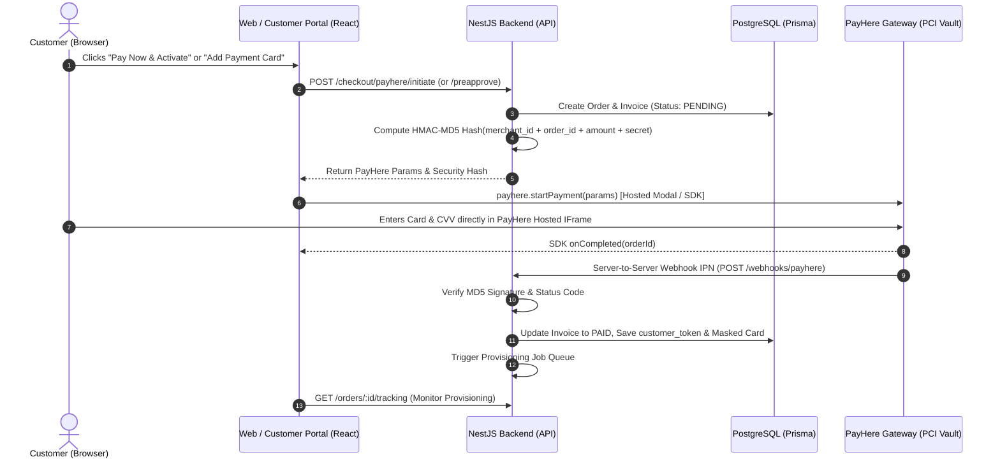

# Server Salad Cloud Services — Complete System API Contract (PCI-DSS & PayHere Hosted)

**Version:** `2.0.0`  
**Base URL:** `https://api.serversalad.com/api/v1`  
**Database & ORM:** PostgreSQL with Prisma ([`prisma/schema.prisma`](file:///c:/Users/navithranviru/Desktop/New%20folder/prisma/schema.prisma))  
**Payment Security Standard:** PCI-DSS Level 1 Hosted Fields & Tokens via PayHere SDK. **Zero raw card numbers, expiry dates, or CVVs** are ever processed by or stored in the React frontend or NestJS backend.

---

## 1. Global Architectural & Security Standards

### 1.1 Authentication & Realm Isolation
The platform operates a dual-token JWT security model with separate role scopes:
- **Customer Realm (`CUSTOMER`):** Authenticates via customer credentials. Has tenant-level isolation (can only access resources where `customerId == req.user.id`).
- **Staff / Admin Realm (`STAFF`):** Authenticates administrative operators. Enforces granular Role-Based Access Control (`StaffRole`):
  - `ADMINISTRATOR`: Super-admin, unrestricted access across all endpoints.
  - `STAFF`: Infrastructure, server management, provisioning, and customer operations. Financial refunds and sensitive config disabled.
  - `SUPPORT_AGENT`: Tickets, live chat, customer inspection. Billing, infrastructure, and settings hidden/forbidden (`403 Forbidden`).
  - `BILLING_STAFF`: Invoices, transactions, subscriptions, refunds, customer billing profile. Server hypervisor nodes and system configs hidden/forbidden (`403 Forbidden`).

#### Standard Headers
```http
Authorization: Bearer <jwt_access_token>
Content-Type: application/json
Accept: application/json
X-Client-Version: 2.0.0
X-Request-ID: <uuid_v4>
Idempotency-Key: <uuid_v4>   # Mandatory for /checkout/order, /payments/:id/refund, and /provisioning/retry
```

---

### 1.2 PCI-DSS Payment Architecture: PayHere Hosted SDK



1. **Checkout Flow (Storefront):** The frontend calls `POST /api/v1/checkout/payhere/initiate`. The NestJS backend calculates the cryptographic HMAC-MD5 hash and returns the parameter set. The React client calls `payhere.startPayment(paymentDetails)`.
2. **Recurring Subscriptions & Saved Cards:** Tokenized using PayHere **Preapproval API**. PayHere returns a secure `customer_token` via server webhook.
3. **Automated Monthly Renewals:** The NestJS backend executes recurring charges server-to-server via the PayHere Charging API using the saved `customer_token`. Zero card data is handled by our app.

---

### 1.3 Standard Response Envelopes

#### Success Envelope (`200 OK`, `201 Created`)
```json
{
  "success": true,
  "statusCode": 200,
  "timestamp": "2026-10-27T15:30:00.000Z",
  "data": {},
  "meta": {
    "page": 1,
    "limit": 20,
    "totalItems": 142,
    "totalPages": 8
  }
}
```

#### Error Envelope (`400`, `401`, `403`, `404`, `409`, `422`, `500`)
```json
{
  "success": false,
  "statusCode": 422,
  "timestamp": "2026-10-27T15:30:00.000Z",
  "error": "UnprocessableEntityException",
  "message": "Validation failed for domain record",
  "details": [
    {
      "field": "domain",
      "issue": "Invalid FQDN format or TLD not supported"
    }
  ],
  "path": "/api/v1/customer/hosting/plans/plan_785df5d6/websites"
}
```

---

## 2. Shared & Authentication Endpoints

### 2.1 Customer Authentication (`/auth`)
*Source files: `web-portal/src/pages/auth/Register.tsx`, `web-portal/src/pages/auth/Login.tsx`*

#### `POST /auth/register`
Creates a new customer account from the storefront registration form.
> **Verified Form Fields (`Register.tsx`):** Only `fullName`, `email`, and `password` are collected on the registration screen (plus client-side `confirmPassword` and `agreeTerms`). No company, phone, or address fields exist on this form.
- **Access:** Public
- **Request Body:**
```json
{
  "fullName": "Alex Jayawardena",
  "email": "alex@domain.com",
  "password": "SecurePassword123!"
}
```
- **Response (`201 Created`):**
```json
{
  "success": true,
  "statusCode": 201,
  "data": {
    "user": {
      "id": "usr_alex_01",
      "fullName": "Alex Jayawardena",
      "email": "alex@domain.com",
      "role": "CUSTOMER"
    },
    "tokens": {
      "accessToken": "eyJhbGciOi...",
      "refreshToken": "eyJhbGciOi...",
      "expiresIn": 3600
    }
  }
}
```

#### `POST /auth/google`
Authenticates or registers a customer via Google OAuth Single Sign-On (from the "Continue with Google" button on `Register.tsx` and `Login.tsx`).
- **Access:** Public
- **Request Body:** `{ "idToken": "eyJhbGciOiJSUzI1NiIs..." }`
- **Response (`200 OK` or `201 Created`):** Returns customer profile and JWT auth tokens.

#### `POST /auth/login`
Authenticates existing customers using credentials.
- **Access:** Public
- **Request Body:**
```json
{
  "email": "alex@domain.com",
  "password": "SecurePassword123!",
  "rememberMe": true
}
```
- **Response (`200 OK`):** Returns customer user and tokens.

#### `POST /auth/refresh`
Rotates access token using stored refresh token.
- **Request Body:** `{ "refreshToken": "eyJhbGciOi..." }`
- **Response (`200 OK`):** Returns refreshed tokens.

#### `POST /auth/forgot-password`
Triggers password reset email with temporary cryptographic token via Resend.
- **Request Body:** `{ "email": "alex@domain.com" }`
- **Response (`200 OK`):** `{ "success": true, "message": "Password reset instructions sent." }`

---

### 2.2 Admin Staff Authentication (`/admin/auth`)

#### `POST /admin/auth/login`
Authenticates staff members and administrators.
- **Request Body:**
```json
{
  "email": "admin@serversalad.net",
  "password": "MasterAdminSecretPassword123!"
}
```
- **Response (`200 OK`):** Returns staff entity (`role: 'ADMINISTRATOR' | 'STAFF' | 'SUPPORT_AGENT' | 'BILLING_STAFF'`) and tokens.

#### `GET /admin/auth/me`
Retrieves authenticated staff profile, active role, and system permissions.

---

## 3. Web Portal (Storefront & Order Flow)

### 3.1 Storefront Catalog & Add-Ons

#### `GET /catalog/products`
Retrieves all publicly available hosting packages.
*Source: `web-portal/src/App.tsx#PricingSection` & `web-portal/src/context/OrderContext.tsx#DEFAULT_PLANS`*
- **Response (`200 OK`):**
```json
{
  "success": true,
  "data": [
    {
      "id": "web",
      "name": "Web Hosting",
      "tagline": "Essential",
      "type": "SHARED",
      "priceMonthlyLkr": 458,
      "priceRenewalUsd": 2.99,
      "cpu": "2x CPU Performance",
      "storage": "50 GB SSD Cloud storage",
      "domainsAllowed": 5,
      "trial": true,
      "features": [
        "Fully optimised for WordPress",
        "2x CPU Performance",
        "50 GB SSD Cloud storage",
        "Unlimited hosted domains",
        "Unlimited websites",
        "Secured by SSL",
        "5 mailboxes per domain free for 1 year"
      ]
    },
    {
      "id": "vps",
      "name": "VPS Hosting",
      "tagline": "Pro Dedicated",
      "type": "VPS",
      "priceMonthlyLkr": 2450,
      "priceRenewalUsd": 12.50,
      "cpu": "4x Dedicated vCPU",
      "storage": "100 GB NVMe Storage",
      "domainsAllowed": 10,
      "trial": false,
      "features": [
        "Dedicated IP Address",
        "4x Dedicated vCPU",
        "100 GB NVMe Storage",
        "Unlimited Bandwidth",
        "Root Access Included",
        "Advanced cPGuard Security",
        "Free Weekly Backups"
      ]
    }
  ]
}
```

#### `GET /catalog/addons/email-plans`
Retrieves Spacemail email add-on plan.
- **Response (`200 OK`):**
```json
{
  "success": true,
  "data": [
    {
      "id": "spacemail-pro",
      "name": "Spacemail Pro",
      "mailboxCount": 1,
      "storageGb": 5,
      "aliasesCount": 10,
      "trialDays": 30,
      "renewalPriceYearlyUsd": 11.76,
      "priceLkr": 0
    }
  ]
}
```

#### `POST /catalog/domains/check`
Validates domain syntax, resolves WHOIS/DNS availability, or verifies pointer status.
- **Request Body:** `{ "domain": "nodegen.com", "type": "external" }`
- **Response (`200 OK`):**
```json
{
  "success": true,
  "data": {
    "domain": "nodegen.com",
    "type": "external",
    "priceLkr": 0, // Registered domains are LKR 3,850/yr; external is 0
    "status": "valid",
    "isPointerConfigured": true,
    "suggestedNameservers": ["ns1.serversalad.com", "ns2.serversalad.com"]
  }
}
```

#### `POST /checkout/promo/validate`
Validates coupon codes (`SALAD50`, `LAUNCH2026`, `COMMUNITY`).
- **Request Body:** `{ "code": "SALAD50", "planId": "web" }`
- **Response (`200 OK`):**
```json
{
  "success": true,
  "data": {
    "valid": true,
    "code": "SALAD50",
    "discountPercentage": 50,
    "message": "50% promotional discount applied successfully."
  }
}
```

---

### 3.2 PayHere Hosted Checkout & Provisioning

#### `POST /checkout/order`
Creates the Order and unpaid Invoice in PostgreSQL via Prisma.
- **Header:** `Idempotency-Key: <uuid_v4>`
- **Request Body:**
```json
{
  "planId": "web",
  "setupMode": "new", // "new" | "migrate"
  "migrationDetails": {
    "sourceUrl": "https://oldcpanel.com",
    "cpanelUser": "user123",
    "notes": "Please migrate WordPress site"
  },
  "domains": [
    {
      "name": "nodegen.com",
      "type": "external",
      "priceLkr": 0
    }
  ],
  "selectedEmailPlan": {
    "id": "spacemail-pro",
    "assignedDomain": "nodegen.com"
  },
  "includeAutoBackup": true,
  "promoCode": "SALAD50",
  "invoiceDetails": {
    "fullName": "Alex Jayawardena",
    "email": "alex@nodegen.com",
    "country": "Sri Lanka",
    "address": "42 Galle Road",
    "city": "Colombo 03",
    "vatNumber": ""
  }
}
```
- **Response (`201 Created`):**
```json
{
  "success": true,
  "data": {
    "orderId": "ord_9204",
    "orderNumber": "ORD-9204",
    "invoiceId": "inv_88129",
    "invoiceNumber": "INV-2026-092",
    "totalLkr": 0, // 0 for trial orders
    "isTrial": true,
    "requiresPaymentGateway": false // true if non-zero amount
  }
}
```

#### `POST /checkout/payhere/initiate`
Generates PayHere Hosted SDK parameters and HMAC-MD5 security hash for non-zero checkouts.
- **Request Body:** `{ "orderId": "ord_9204" }`
- **Response (`200 OK`):**
```json
{
  "success": true,
  "data": {
    "sandbox": true,
    "merchant_id": "1224890",
    "return_url": "https://serversalad.com/order/processing?orderId=ord_9204",
    "cancel_url": "https://serversalad.com/order/checkout",
    "notify_url": "https://api.serversalad.com/api/v1/webhooks/payhere",
    "order_id": "ORD-9204",
    "items": "Web Hosting Essential - nodegen.com",
    "amount": "458.00",
    "currency": "LKR",
    "hash": "D98A7B6C4F3E2D1A0B9C8E7F6A5B4C3D",
    "first_name": "Alex",
    "last_name": "Jayawardena",
    "email": "alex@nodegen.com",
    "phone": "+94771234567",
    "address": "42 Galle Road",
    "city": "Colombo 03",
    "country": "Sri Lanka"
  }
}
```

#### `GET /orders/:id/tracking`
Polls the 6 provisioning steps shown on `web-portal/src/pages/order/Provisioning.tsx`.
- **Response (`200 OK`):**
```json
{
  "success": true,
  "data": {
    "orderId": "ord_9204",
    "status": "PROCESSING",
    "currentStep": 4,
    "steps": [
      { "id": 1, "label": "Order confirmed & invoice generated", "status": "COMPLETED" },
      { "id": 2, "label": "Payment authorization verified", "status": "COMPLETED" },
      { "id": 3, "label": "Provisioning NVMe cloud storage container", "status": "COMPLETED" },
      { "id": 4, "label": "Configuring cPanel & WHM control environment", "status": "RUNNING" },
      { "id": 5, "label": "Issuing Let's Encrypt wildcard SSL certificate", "status": "PENDING" },
      { "id": 6, "label": "Hosting service activated & live", "status": "PENDING" }
    ],
    "service": {
      "id": "srv_41029",
      "primaryDomain": "nodegen.com",
      "status": "PROVISIONING"
    }
  }
}
```

---

## 4. Customer Portal (Self-Service Dashboard)

### 4.1 Hosting Service Management
*Source: `customer-portal/src/types/hosting.ts`, `customer-portal/src/data/mockHostingData.ts`*

#### `GET /customer/hosting/plans`
Lists all hosting plans owned by the authenticated customer.

#### `GET /customer/hosting/plans/:id`
Retrieves detailed real-time hosting plan status, quotas, and server metrics.
- **Response (`200 OK`):**
```json
{
  "success": true,
  "data": {
    "id": "plan_785df5d6",
    "name": "Web Hosting Essential",
    "tier": "Essential SSD NVMe",
    "status": "active", // "active" | "needs_dns" | "provisioning" | "suspended"
    "primaryDomain": "freshkitchen.io",
    "serverHost": "cp1.serversalad.com",
    "serverIp": "198.51.100.42",
    "controlPanelPort": 8083,
    "hestiaUsername": "usr_salad_84",
    "productId": "785df5d6-7b0b-43c2-8d55-9cc92e677dad",
    "startedAt": "Jan 13, 2026",
    "updatedAt": "Oct 13, 2026",
    "renewalDate": "Nov 15, 2026",
    "renewalPrice": 9.99,
    "billingCycle": "monthly",
    "autoRenew": true,
    "storageUsedGb": 8.4,
    "storageTotalGb": 25.0,
    "storageBreakdown": {
      "webGb": 5.6,
      "dbGb": 1.8,
      "mailGb": 0.7,
      "backupGb": 0.3
    },
    "bandwidthUsedGb": 42.6,
    "bandwidthTotalGb": 500.0,
    "domainCount": 2,
    "domainLimit": 5,
    "websiteCount": 2,
    "inodesUsed": 68420,
    "inodesTotal": 250000,
    "phpVersion": "8.3",
    "availablePhpVersions": ["8.1", "8.2", "8.3", "8.4"],
    "webServer": "Nginx + PHP-FPM",
    "sslActive": true,
    "dnsNameservers": ["ns1.serversalad.com", "ns2.serversalad.com"],
    "backupSummary": {
      "lastBackup": "Today at 03:00 UTC",
      "retentionDays": 14,
      "frequency": "Daily Automated",
      "snapshotSizeGb": 2.1,
      "totalSnapshots": 14
    },
    "mailboxesUsed": 2,
    "mailboxesLimit": 10
  }
}
```

#### `POST /customer/hosting/plans/:id/sso-session`
Generates a one-time SSO redirect URL into HestiaCP/cPanel without exposing credentials.
- **Response (`200 OK`):** `{ "redirectUrl": "https://cp1.serversalad.com:8083/login/?token=sso_token_991823" }`

#### `PATCH /customer/hosting/plans/:id/auto-renew`
Toggles subscription auto-renewal.
- **Request Body:** `{ "autoRenew": true }`

#### `PATCH /customer/hosting/plans/:id/php-version`
Switches server PHP version (`8.1`, `8.2`, `8.3`, `8.4`).
- **Request Body:** `{ "phpVersion": "8.4" }`

#### `POST /customer/hosting/plans/:id/cancel`
Submits a service cancellation request.
- **Request Body:** `{ "reason": "No longer needed" }`
- **Response (`200 OK`):** `{ "ticketId": "TICK-419208", "message": "Cancellation request submitted." }`

---

### 4.2 Websites / Virtual Host Management

#### `GET /customer/hosting/plans/:id/websites`
Lists all virtual hosts for this hosting container.

#### `POST /customer/hosting/plans/:id/websites`
Adds a new website to the hosting container.
- **Request Body:**
```json
{
  "domain": "craftsalad.dev",
  "appType": "WordPress", // "WordPress" | "PHP/Static" | "Node.js" | "Laravel" | "Custom"
  "phpVersion": "8.3"
}
```
- **Response (`201 Created`):** Returns created `Website` entity.

#### `DELETE /customer/hosting/websites/:id`
Deletes a website and its document root.

---

### 4.3 Customer Billing & PayHere Hosted Preapproval

#### `GET /customer/billing/summary`
- **Response (`200 OK`):**
```json
{
  "success": true,
  "data": {
    "currentPlanName": "Web Hosting Essential",
    "currentPlanPrice": 9.99,
    "billingCycle": "monthly",
    "nextBillingDate": "Nov 15, 2026",
    "autoRenew": true,
    "creditBalance": 25.0
  }
}
```

#### `GET /customer/billing/invoices`
Lists customer invoices with pagination.

#### `GET /customer/billing/invoices/:id/pdf`
Streams the binary PDF invoice (`Content-Type: application/pdf`).

#### `GET /customer/billing/payment-methods`
Lists saved tokenized credit cards (Masked only: zero raw PAN/CVV).
- **Response (`200 OK`):**
```json
{
  "success": true,
  "data": [
    {
      "id": "pm_01",
      "provider": "PAYHERE",
      "brand": "VISA",
      "last4": "4242",
      "expMonth": 8,
      "expYear": 2028,
      "cardholderName": "John Doe",
      "isDefault": true
    }
  ]
}
```

#### `POST /customer/billing/payhere/preapprove`
Generates PayHere Preapproval authorization hash to open PayHere's hosted card tokenization modal.
- **Request Body:** `{ "isDefault": true }`
- **Response (`200 OK`):**
```json
{
  "success": true,
  "data": {
    "sandbox": true,
    "merchant_id": "1224890",
    "return_url": "https://serversalad.com/billing?preapproved=success",
    "cancel_url": "https://serversalad.com/billing",
    "notify_url": "https://api.serversalad.com/api/v1/webhooks/payhere",
    "order_id": "PREAUTH-88219",
    "items": "Server Salad Preapproval Vault",
    "currency": "LKR",
    "hash": "F8E7D6C5B4A3..."
  }
}
```

#### `PATCH /customer/billing/payment-methods/:id/default`
Sets card as default for recurring subscriptions.

#### `DELETE /customer/billing/payment-methods/:id`
Deletes a saved card token.

#### `GET /customer/billing/address`
Retrieves tax & legal entity billing address.

#### `PUT /customer/billing/address`
Updates billing address.
- **Request Body:**
```json
{
  "companyName": "Fresh Kitchen Media S.A.",
  "contactName": "Sarah Jenkins",
  "email": "sarah.jenkins@serversalad.cloud",
  "vatId": "LU3029104",
  "addressLine1": "2-4, Rue Edmond Reuter",
  "addressLine2": "Suite 400",
  "city": "Contern",
  "postalCode": "L-5326",
  "country": "Luxembourg"
}
```

#### `POST /customer/billing/redeem-promo`
Redeems account credit vouchers (`SALAD10`, `SALAD2026`, `WELCOME25`).
- **Request Body:** `{ "code": "WELCOME25" }`
- **Response (`200 OK`):** `{ "success": true, "creditAdded": 25.0 }`

---

### 4.4 Profile, Account Security & Notifications

#### `GET /customer/profile`
Retrieves user profile, localization, SSH keys, and active web sessions.

#### `PATCH /customer/profile`
Updates contact settings, company, timezone, language, and notification alert toggles.
- **Request Body:**
```json
{
  "name": "Sarah Jenkins",
  "email": "sarah.jenkins@serversalad.cloud",
  "phone": "+1 (555) 382-9014",
  "company": "Fresh Kitchen Media S.A.",
  "timezone": "UTC+00:00 (London, Lisbon)",
  "language": "English (United States)",
  "emailDigest": true,
  "securityAlerts": true,
  "billingAlerts": true
}
```

#### `POST /customer/profile/change-password`
- **Request Body:** `{ "currentPassword": "...", "newPassword": "..." }`

#### `POST /customer/profile/2fa/toggle`
Toggles Two-Factor Authentication (TOTP).

#### `GET /customer/profile/2fa/recovery-codes`
Downloads 10 backup emergency recovery codes.

#### `POST /customer/profile/ssh-keys`
- **Request Body:** `{ "name": "Workstation", "keyString": "ssh-rsa AAAAB3..." }`

#### `DELETE /customer/profile/ssh-keys/:id`

#### `DELETE /customer/profile/sessions/:id`
Revokes an individual session.

#### `POST /customer/profile/sessions/revoke-others`
Revokes all other active sessions except the current one.

#### `DELETE /customer/profile`
Permanently closes and deactivates the customer account.
- **Request Body:** `{ "confirmation": "DELETE" }`

#### `GET /customer/notifications`
#### `PATCH /customer/notifications/:id/read`
#### `PATCH /customer/notifications/read-all`
#### `DELETE /customer/notifications/:id`
#### `DELETE /customer/notifications` (clear all)

---

### 4.5 New Hosting Product Catalog
*Source: `customer-portal/src/app/hosting/new/page.tsx`*

#### `GET /customer/hosting/catalog`
Lists available hosting instance tiers and regions (`lon1`, `sri1`).

---

## 5. Admin Portal (Operations & Infrastructure)

### 5.1 Infrastructure: Servers & Hypervisors (`/admin/servers`)

#### `GET /admin/servers`
Lists all hosting nodes (WHM/cPanel and Proxmox KVM).
- **Access:** `ADMINISTRATOR`, `STAFF`

#### `POST /admin/servers`
Registers a new hypervisor or hosting server node.
- **Request Body:**
```json
{
  "name": "FRA-WEB-NODE-03",
  "hostname": "fra03.serversalad.net",
  "ipAddress": "185.190.140.24",
  "provider": "WHM_CPANEL", // "WHM_CPANEL" | "PROXMOX_KVM" | "HETZNER_CLOUD" | "AWS_EC2"
  "serverType": "SHARED_HOSTING",
  "datacenter": "Frankfurt, Germany (FRA-DC2)",
  "location": "Frankfurt, DE",
  "accountsLimit": 250,
  "allocationEnabled": true,
  "providerConfig": {
    "port": 2087,
    "useSsl": true,
    "apiUsername": "root",
    "apiToken": "WHMAPITOKENSECRET",
    "clusterNode": "pve-node-beta", // only for PROXMOX_KVM
    "nameservers": ["ns1.serversalad.com", "ns2.serversalad.com"]
  },
  "notes": "Configured in Frankfurt"
}
```

#### `POST /admin/servers/:id/test-connection`
Executes socket ping handshake to verify API connectivity.

#### `POST /admin/servers/:id/health-check`
Polls live CPU, RAM, disk, and socket health from the node.

#### `PATCH /admin/servers/:id/allocation`
Toggles automated order placement onto this server.
- **Request Body:** `{ "allocationEnabled": boolean }`

#### `PATCH /admin/servers/:id/maintenance`
#### `DELETE /admin/servers/:id`

---

### 5.2 Server Groups (`/admin/server-groups`)
*Source: `admin-portal/src/components/pages/ServerGroupsPage.tsx`*

#### `GET /admin/server-groups`
#### `POST /admin/server-groups`
- **Request Body:**
```json
{
  "name": "Frankfurt NVMe Group (FRA-POOL-01)",
  "purpose": "SHARED_HOSTING",
  "provider": "WHM_CPANEL",
  "location": "Frankfurt, Germany",
  "allocationPolicy": "BALANCED", // "BALANCED" | "PACK_FIRST" | "MANUAL"
  "serverIds": ["srv_fra_01", "srv_fra_02"],
  "enabled": true,
  "description": "Primary high-performance web cluster"
}
```
#### `PATCH /admin/server-groups/:id`
#### `DELETE /admin/server-groups/:id`

---

### 5.3 Products & Packages (`/admin/products`)

#### `GET /admin/products`
#### `POST /admin/products`
- **Request Body:**
```json
{
  "name": "Turbo NVMe Pro Plus",
  "slug": "turbo-nvme-pro-plus",
  "type": "SHARED",
  "tagline": "High performance",
  "description": "Optimized WordPress cPanel",
  "priceMonthly": 14.99,
  "priceAnnual": 149.90,
  "storageGb": 50,
  "domainLimit": 10,
  "bandwidthGb": 1000,
  "emailAccounts": 10,
  "databases": 5,
  "whmPackageName": "salad_turbo_pro_plus",
  "serverGroupId": "sg_shared_eu",
  "vCpuCores": 2, // VPS
  "ramGb": 4, // VPS
  "diskType": "NVMe SSD",
  "published": true
}
```
#### `PATCH /admin/products/:id`
#### `POST /admin/products/:id/duplicate`
#### `PATCH /admin/products/:id/publish`
#### `PATCH /admin/products/:id/disable-sales`
#### `DELETE /admin/products/:id`

---

### 5.4 Customer Administration (`/admin/customers`)

#### `GET /admin/customers`
#### `POST /admin/customers`
Admin manually registers a customer.
- **Request Body:**
```json
{
  "name": "Daniel Vance",
  "email": "daniel@vancegrowth.com",
  "company": "Vance Growth Ltd",
  "phone": "+44 7700 900077",
  "billingAddress": {
    "line1": "100 Bishopsgate",
    "city": "London",
    "country": "United Kingdom",
    "postalCode": "EC2N 4AG"
  }
}
```
#### `GET /admin/customers/:id`
#### `PATCH /admin/customers/:id`
#### `PATCH /admin/customers/:id/toggle-login`
#### `PATCH /admin/customers/:id/toggle-hosting`
#### `POST /admin/customers/:id/notes`
#### `POST /admin/customers/:id/reset-password`

---

### 5.5 Orders & Provisioning Pipeline (`/admin/orders` & `/admin/provisioning`)

#### `GET /admin/orders`
#### `GET /admin/orders/:id`
#### `PATCH /admin/orders/:id/status`
#### `POST /admin/orders/:id/approve-provision`
Approves an order, allocates a server, and queues a provisioning job.
#### `POST /admin/orders/:id/cancel`
#### `POST /admin/orders/:id/notes`
#### `GET /admin/provisioning/jobs`
#### `GET /admin/provisioning/jobs/:id`
#### `POST /admin/provisioning/jobs/:id/retry`
#### `POST /admin/provisioning/jobs/:id/cancel`

---

### 5.6 Hosting Services Management (`/admin/services`)

#### `GET /admin/services`
#### `GET /admin/services/:id`
#### `POST /admin/services/:id/suspend` (`{ "reason": "..." }`)
#### `POST /admin/services/:id/unsuspend`
#### `POST /admin/services/:id/terminate`
#### `POST /admin/services/:id/migrate-server` (`{ "targetServerId": "..." }`)
#### `POST /admin/services/:id/change-package` (`{ "newProductId": "..." }`)

---

### 5.7 Invoices, Payments & Refunds (`/admin/invoices`, `/admin/payments`, `/admin/subscriptions`)

#### `GET /admin/invoices`
#### `POST /admin/invoices` (manual invoice)
#### `POST /admin/invoices/:id/apply-credit`
#### `POST /admin/invoices/:id/void`
#### `POST /admin/invoices/:id/resend`
#### `GET /admin/payments`
#### `POST /admin/payments/:id/refund`
Executes an authorized refund via PayHere or Stripe.
- **Header:** `Idempotency-Key: <uuid>`
- **Access:** `ADMINISTRATOR`, `BILLING_STAFF` (`STAFF` and `SUPPORT_AGENT` receive `403 Forbidden`)
- **Request Body:** `{ "amount": 49.00, "reason": "Customer requested duplicate charge reversal" }`
- **Response (`200 OK`):** `{ "success": true, "status": "REFUNDED", "refundedAmount": 49.00 }`
#### `GET /admin/subscriptions`
#### `GET /admin/subscriptions/:id`
#### `PATCH /admin/subscriptions/:id`
#### `POST /admin/subscriptions/:id/retry-renewal`
#### `POST /admin/subscriptions/:id/cancel`

---

### 5.8 Support Tickets, Live Chat & System Operations

#### `GET /admin/tickets`
#### `GET /admin/tickets/:id`
#### `POST /admin/tickets/:id/reply` (`{ "content": "...", "isInternalNote": true }`)
#### `PATCH /admin/tickets/:id` (`department`, `priority`, `status`, `assignedAgentId`)
#### `GET /admin/live-chat/sessions`
#### `POST /admin/live-chat/sessions/:id/claim`
#### `POST /admin/live-chat/sessions/:id/messages`
#### `POST /admin/live-chat/sessions/:id/close`
#### `GET /admin/domains`
#### `POST /admin/domains/:id/check-dns`
#### `POST /admin/domains/:id/reissue-ssl`
#### `GET /admin/notifications`
#### `POST /admin/notifications/:id/retry`
#### `GET /admin/email-templates`
#### `PATCH /admin/email-templates/:id`
#### `GET /admin/staff`
#### `POST /admin/staff`
#### `PATCH /admin/staff/:id/role`
#### `PATCH /admin/staff/:id/status`
#### `GET /admin/audit-logs`
#### `GET /admin/settings`
#### `PATCH /admin/settings`
#### `POST /admin/settings/whm/test`
#### `POST /admin/settings/payhere/test`
#### `GET /admin/reports/analytics` (`?range=7d|30d|mtd|ytd`)

---

## 6. Webhooks & Real-Time Protocols

### 6.1 PayHere Payment Gateway Webhook (`/webhooks/payhere`)
Handles both checkout payment settlements and customer preapproval tokenization.
- **Access:** Public (Signature Verified)
- **Signature Verification:**
  `md5sig = strtoupper(md5(merchant_id + order_id + payhere_amount + payhere_currency + status_code + strtoupper(md5(merchant_secret))))`
- **Checkout Payment Payload:**
```json
{
  "merchant_id": "1224890",
  "order_id": "ORD-9204",
  "payment_id": "320025184910",
  "payhere_amount": "458.00",
  "payhere_currency": "LKR",
  "status_code": "2", // 2 = Success, 0 = Pending, -1 = Canceled, -2 = Failed
  "md5sig": "E4D909C290D0FB1CA068FFADD...",
  "custom_1": "usr_alex_01",
  "custom_2": "inv_88129"
}
```
- **Preapproval Tokenization Webhook Payload:**
```json
{
  "merchant_id": "1224890",
  "order_id": "PREAUTH-88219",
  "customer_token": "ct_99a8b1c7d34e20984",
  "card_holder_name": "Alex Jayawardena",
  "card_no": "************4242",
  "card_expiry": "08/28",
  "status_code": "2",
  "md5sig": "A1B2C3D4E5F6..."
}
```
- **Backend Action:** Stores masked card info (`brand: VISA`, `last4: 4242`, `expMonth: 8`, `expYear: 2028`) and `customer_token` on the `PaymentMethod` model in PostgreSQL via Prisma.

---

### 6.2 Real-Time WebSocket Protocols (`wss://api.serversalad.com/ws`)

#### 1. Live Support Chat (`/ws/live-chat`)
- **Query:** `wss://api.serversalad.com/ws/live-chat?token=<jwt>`
- **Client -> Server:** `join_session`, `send_message`, `typing`
- **Server -> Client:** `message_received`, `agent_claimed`, `session_closed`

#### 2. Provisioning Real-Time Timeline (`/ws/provisioning`)
- **Query:** `wss://api.serversalad.com/ws/provisioning?jobId=job_8841`
- **Server -> Client:** `step_progress`, `job_completed`, `job_failed`
